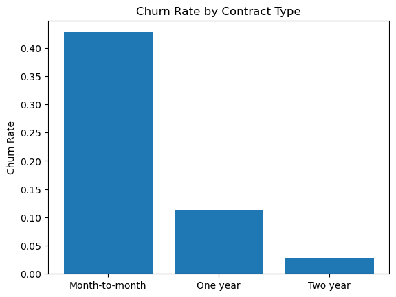

# Telecom Customer Churn Analysis

End-to-end machine learning project predicting customer churn for a telecommunications company. Uses the IBM Telco Customer Churn dataset to identify high-risk customers and the behavioral and contractual factors that drive attrition. Combines exploratory data analysis, feature engineering, and a comparison of three classification models (Logistic Regression, Random Forest, XGBoost) interpreted with SHAP.

## TL;DR

- Predicted churn for **7,032** telecom customers; a threshold-tuned Logistic Regression catches **76% of customers who churn**, so the retention team can reach them first.
- New customers on month-to-month contracts (an engineered `HighRisk` flag) churn at **51.9% vs 17.1%** for everyone else.
- Contract length is the clearest lever: **42.7%** churn on month-to-month vs **2.8%** on two-year contracts.



## Business Problem

Customer churn is one of the most expensive problems in subscription businesses — acquiring a new customer typically costs 5–7x more than retaining an existing one. The goal of this project is twofold:

1. **Predict** which customers are most likely to churn so the retention team can intervene proactively.
2. **Explain** *why* customers churn so the business can address root causes through pricing, contract design, and customer experience changes.

## Dataset

- **Source:** IBM Telco Customer Churn (publicly available on Kaggle)
- **Rows:** 7,032 customers (after dropping rows with missing `TotalCharges`)
- **Target:** `Churn` (binary — 26.6% positive class)
- **Features:** 23 features covering demographics, account information (tenure, contract type, payment method), and service subscriptions (phone, internet, streaming, security add-ons)

## Project Structure

```
telecom-churn-analysis/
├── data/
│   ├── telco_customer_churn.csv       # raw dataset
│   ├── clean_telco_df.csv             # cleaned + encoded dataset
│   └── churn_dashboard_data.csv       # scored data for downstream BI use
├── notebooks/
│   ├── 01_data_cleaning.ipynb         # data type fixes, encoding, missing values
│   ├── 02_eda.ipynb                   # exploratory analysis & feature discovery
│   └── 03_modeling.ipynb              # model training, tuning, and interpretation
├── requirements.txt
├── LICENSE
└── README.md
```

## Methodology

### 1. Data Cleaning (`01_data_cleaning.ipynb`)
- Dropped `customerID` (no predictive value).
- Converted `TotalCharges` to numeric and dropped 11 rows with missing values.
- Collapsed "No internet service" / "No phone service" responses into "No" for binary service features.
- One-hot encoded `Contract`, `InternetService`, and `PaymentMethod` (with the most common level as baseline).
- Label-encoded remaining binary categorical columns.

### 2. Exploratory Data Analysis (`02_eda.ipynb`)
Key churn-rate findings from segment analysis:

| Segment | Churn Rate |
|---|---|
| Month-to-month contract | 42.7% |
| One-year contract | 11.3% |
| Two-year contract | 2.8% |
| Fiber optic internet | 41.9% |
| Non-fiber | 14.5% |
| Pays via electronic check | 45.3% |
| Other payment methods | 17.1% |
| Senior citizens | 41.7% |
| Non-senior | 23.7% |

Feature-engineered a `HighRisk` flag (`tenure < 12 months` AND `month-to-month contract`). This single derived feature isolates a segment with **51.9% churn** vs 17.1% for the rest of the customer base.

### 3. Modeling (`03_modeling.ipynb`)
- 80/20 stratified train/test split (`random_state=42`).
- StandardScaler applied for the linear model only.
- Compared three classifiers, tuned hyperparameters and decision thresholds, and used SHAP to interpret the gradient-boosted model.

## Results

| Model | Accuracy | ROC-AUC | Recall (churn) | Precision (churn) |
|---|---|---|---|---|
| Logistic Regression (baseline) | 0.788 | 0.833 | 0.53 | 0.62 |
| Logistic Regression (threshold = 0.3) | 0.74 | 0.833 | **0.76** | 0.51 |
| Random Forest (default) | 0.79 | 0.816 | 0.51 | 0.62 |
| **Random Forest (tuned)** | **0.79** | **0.838** | 0.49 | 0.65 |
| XGBoost (default) | 0.76 | 0.816 | 0.49 | 0.56 |

**Tuned Random Forest** delivered the strongest ROC-AUC (0.838). For a retention use case where missing a churner is more costly than a false alarm, the **threshold-tuned Logistic Regression** is the more practical operating point — it recovers 76% of would-be churners at the cost of more outreach to non-churners.

### Top Drivers of Churn (SHAP / feature importance)
1. **HighRisk flag** (new + month-to-month customers)
2. **Fiber optic internet** service
3. **Tenure** / **TotalCharges** (proxies for customer maturity)
4. **Contract type** (longer contracts strongly protective)
5. **Electronic check** payment method

## Business Recommendations
- **Lock in new customers early.** The HighRisk segment churns at 52%. Offer first-year contract incentives or onboarding programs in months 1–12.
- **Investigate fiber.** Fiber customers churn at nearly 3x the rate of other internet users — likely a quality, pricing, or expectation issue rather than a service-mix issue.
- **Migrate electronic-check payers** to autopay. The 45% churn rate among electronic-check customers points to either a billing-friction or self-selection effect worth investigating.
- **Senior citizens** are an underserved segment with 1.7x the churn of younger customers — investigate accessibility and customer-service experience.

## How to Reproduce

```bash
# clone the repo
git clone https://github.com/handillon1/telecom-churn-analysis.git
cd telecom-churn-analysis

# create a virtual environment (optional but recommended)
python -m venv venv
venv\Scripts\activate           # Windows
# source venv/bin/activate      # macOS / Linux

# install dependencies
pip install -r requirements.txt

# launch Jupyter and run the notebooks in order
jupyter notebook
```

## Tech Stack
- **Python 3.10+**
- **pandas / numpy** — data wrangling
- **matplotlib / seaborn** — visualization
- **scikit-learn** — Logistic Regression, Random Forest, preprocessing, metrics
- **xgboost** — gradient boosting
- **shap** — model interpretability

## Dashboard Preview

Interactive version: **[Tableau Public →](https://public.tableau.com/app/profile/dillon.han3625/viz/ChurnDashboard_17776804274370/TelecoChurnDashboard)**

## Author
**Dillon Han**
[GitHub](https://github.com/handillon1) · [LinkedIn](https://www.linkedin.com/in/dillon-han-a640a0337/)

## License
This project is released under the MIT License — see [LICENSE](LICENSE) for details.
